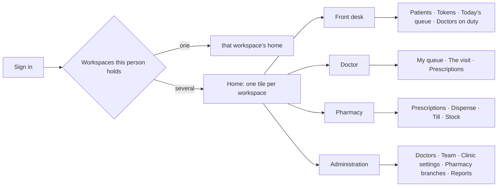
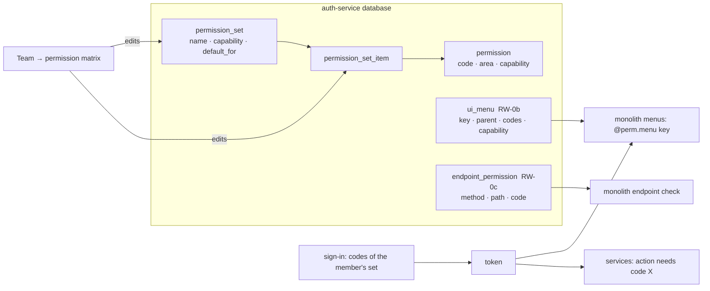

# HMS — role workspaces (front desk · doctor · pharmacy · administration)

2026-10-12 · status: **DECIDED (§6) — RW-1 built, not deployed** · slice prefix `RW-`

The client walked the Test Book as `hms.reception@myplus.test` and found it "not professional": the reception desk can
open the pharmacy and see the clinic's settings. This document reviews why, how hospital systems solve it, and
proposes the design. Nothing here is built yet.

---

## 1. What is wrong today (verified 2026-10-12, not assumed)

| # | Finding | Evidence |
|---|---|---|
| F1 | **"Clinic reception" is a pharmacy clerk.** The built-in set is *Standard minus `rx.dispense`*: purchases, products, prices, stock, suppliers, till, **reports**. | `permission_set_item` for "Clinic reception" (22 codes; Standard has the same + `rx.dispense`) |
| F2 | **The clinic has ONE permission** — `clinic.consult` (the doctor). Patients, tokens, the queue and doctors' days are open to anybody once the clinic is switched on. | `permission` table: 1 `clinic.*` code (education has ~40 of its own) |
| F3 | **Everyone lands on the pharmacy dashboard.** A pharmacy business routes every login to `/businessDashboard`; the reception desk lands on *Revenue this month* and *Stock value*. | `ModuleRouter.dashboardFor` → `COMMERCE_DASHBOARD` for PHARMA; screenshot FA-04 run |
| F4 | **Set-up screens are shown to everyone.** "Doctors" and "Clinic settings" have no role check in the menu. The server does refuse a non-admin save, so reception sees screens it cannot use. | `clinicDashboard.html` menu (no `sec:authorize`); `ClinicSettingsController` `@PreAuthorize(OWNER/ADMIN)` |
| F5 | **A doctor's day is open to all** — the patients-a-day limit and "not today" can be set by anyone in the clinic. | `QueueService.setDay` checks only `assertModuleOn()` |
| F6 | **The clinic is a menu item of the pharmacy** (Pharmacy → Clinic reception), not a place of its own. | `businessDashboard.html` `#navClinic` |

What is already right and stays: the doctor sees only his own queue when linked (H2); registering / linking doctors is
owner/admin only on the server; settings writes are owner/admin only on the server; dispensing needs `rx.dispense`.

## 2. How hospital systems do it

| System | What it does | Source |
|---|---|---|
| **Bahmni** (OpenMRS-based HMS) | The home page shows only the **apps** the user holds a privilege for (`requiredPrivilege` per app tile); Registration, Clinical, Pharmacy/Billing are separate apps. Registration has its own read / write / visit-action roles. | [EMR security and access control](https://bahmni.atlassian.net/wiki/spaces/BAH/pages/48889893) · [Billing/Pharmacy app](https://bahmni.atlassian.net/wiki/spaces/BAH/pages/115777052/Billing+Pharmacy+App) |
| **Bahmni appointments** | Three levels: *Read only*, *Manage appointments* (check-in, cancel, add — **admin tab hidden**), *Full access* (also the admin tab). Queues can be restricted by privilege. | [Roles and privileges for appointment scheduling](https://bahmni.atlassian.net/wiki/spaces/BAH/pages/144801828/User+Roles+and+Privileges+for+Appointment+Scheduling) · [Privilege-based access to patient queues](https://bahmni.atlassian.net/wiki/spaces/BAH/pages/3171057680/Privilege+based+access+to+Patient+Queues) |
| **ERPNext Healthcare** | Set-up and settings need the **Healthcare Administrator** role; a practitioner is LINKED to a user and given roles; clinical fields are visible only to Physician / Nursing roles. | [Healthcare practitioner](https://docs.frappe.io/erpnext/v13/user/manual/en/healthcare/healthcare_practitioner) · [Healthcare settings](https://docs.frappe.io/erpnext/v13/user/manual/en/healthcare/healthcare_settings) · [Inpatient ADT](https://docs.frappe.io/erpnext/v13/user/manual/en/healthcare/inpatient_adt) |
| **OpenMRS** | "Every user should have its own workflow, and the home page should be role specific." | [Role-based home page (2009 proposal)](https://google-melange.com/archive/gsoc/2009/orgs/openmrs/projects/harshini.html) |

The common pattern (named: **role-based workspaces**): each job is a *workspace* with its own home, menu and
permissions; set-up lives in an **Administration** workspace only administrators see; a person with two jobs sees two
tiles, never a mixed menu.

## 3. The design

### 3.1 Workspaces and who sees them

| Workspace | Home | Menu | Built-in set that opens it |
|---|---|---|---|
| **Front desk** | Today's queue | Patients · Issue token · Today's queue · Doctors on duty (read; mark "not today" if D2 = yes) · Collect consultation fee (if D1 = yes) | **Front desk** (renamed from "Clinic reception") |
| **Doctor** | My queue | My queue · The visit · Prescriptions I wrote | **Doctor** (unchanged) |
| **Pharmacy** | Prescriptions to fill | Prescriptions · Dispense · Till · Products/stock (view) | **Pharmacist** (today's "Standard") |
| **Pharmacy store** | Stock | Purchases · Suppliers · Products · Stock | **Store keeper** (if D3 = separate) |
| **Administration** | Hospital overview: patients today, doctors on duty, prescriptions waiting, takings | Doctors · Team · Clinic settings · Pharmacy branches · Reports · Configuration | owner, **Administrator** |

### 3.2 Clinic permissions (new codes, area "Clinic")

| Code | Allows | Front desk | Doctor | Pharmacist | Admin |
|---|---|:-:|:-:|:-:|:-:|
| `clinic.patient.view` | find a patient | ✔ | ✔ | ✔ | ✔ |
| `clinic.patient.edit` | register / correct a patient | ✔ | | | ✔ |
| `clinic.token.issue` | issue, relink a token | ✔ | | | ✔ |
| `clinic.token.cancel` | cancel with a reason | ✔ | | | ✔ |
| `clinic.queue.view` | today's queue board | ✔ | ✔ | | ✔ |
| `clinic.doctor.day` | patients-a-day, "not today" | D2 | | | ✔ |
| `clinic.consult` | the visit, notes, prescriptions | | ✔ | | (owner) |
| `clinic.doctor.manage` | add / register / link doctors, pharmacy branch | | | | ✔ |
| `clinic.settings` | clinic settings | | | | ✔ |

Every code is enforced **on the server** (clinical-service `ClinicAccess`), and the screen shows only what the person
holds — a hidden button is convenience, the server refusal is the control (STANDARDS §0c).

### 3.3 Sign-in lands on the person's own workspace

`ModuleRouter` gains one rule for a clinic business: holds `clinic.consult` only → **Doctor**; holds front-desk codes
and no pharmacy codes → **Front desk**; holds `rx.dispense` → **Pharmacy**; owner/admin → **Administration overview**;
several → the **tile home**. Revenue and stock value appear only on Administration (and for `report.view`).

### 3.4 Moving existing businesses (automatic on deploy, no manual step)

A Flyway migration in auth-service rewrites the **built-in** sets only (custom sets are the owner's and untouched):
"Clinic reception" → "Front desk" with the clinic codes and none of the pharmacy back-office codes; "Standard" keeps
everything and gains the pharmacy-side clinic read codes; members stay on their set. Before it runs, a pre-flight query
lists every member who would LOSE a code (e.g. a reception member who receives stock) — the client decides (D5).

## 4. The owner's end-to-end journey (the Test Book becomes this order)

1. **Sign in as the owner** → Administration overview.
2. **Switch the clinic on** (Configuration) — once.
3. **Pharmacy branches** — check / name them.
4. **Doctors** → Register a doctor with their login; set fee, patients a day, pharmacy branch.
5. **Team** → add the front desk and the pharmacist; each on their set; each sets a password from the e-mail.
6. **Front desk** signs in → lands on Today's queue → registers a patient → issues a token for the doctor.
7. **Doctor** signs in → lands on My queue → calls, sees, prescribes.
8. **Pharmacist** signs in → lands on Prescriptions → dispenses → takes payment.
9. **Owner** → overview: the patient, the visit, the prescription and the takings, end to end.

Each step = a Cypress case with screenshots + the manual steps on the Test Book (same ids), and the refusal cases:
front desk cannot open Administration / pharmacy stock (screen AND server), doctor cannot dispense, pharmacist cannot
change clinic settings.

## 5. Slices

| Slice | Delivers | Gate |
|---|---|---|
| RW-1 | clinic permission codes + server checks + the built-in sets (§3.2, §3.4) | unit tests per check; Cypress refusal cases per role |
| RW-2 | menus show only what the person holds; no Doctors / Clinic settings for the front desk | Cypress per role: visible AND refused |
| RW-3 | sign-in lands on the own workspace; tile home for several | Cypress: four accounts land where §3.3 says |
| RW-4 | Administration overview (no revenue for others) | Cypress: KPI cards per role |
| RW-5 | the owner's journey (§4) as the Test Book's first section | full Cypress run + manual walk |

## 6. Decisions for the client

| # | Question | Options |
|---|---|---|
| D1 | Does the front desk **collect the consultation fee**? | (a) yes, through the till
| D2 | Who sets a doctor's day (patients a day, "not today")? | (a) the front desk too (a doctor phones in sick) · (b) administration only | both
| D3 | Does the pharmacist **receive stock** (purchases, suppliers)? | (a) yes — a separate Store keeper or (b) administration 
| D4 | One person, two jobs (owner who is also the doctor; pharmacist who covers the desk)? | (a) tile home, switch between workspaces · (b) one merged menu | both
| D5 | Existing members of "Clinic reception" who lose pharmacy codes | (a) move them automatically (list shown before deploy)

### Decisions as taken (client, 2026-10-12)

| # | Ruling | Built as |
|---|---|---|
| D1 | the front desk collects the fee through the till | "Clinic reception" keeps sale.create/view, till, customers, product/stock VIEW; loses purchases, suppliers, product/stock edits, reports, discounts, sale edits |
| D2 | both the front desk and the administration set a doctor's day | `clinic.doctor.day` in Clinic reception, Standard, Administrator |
| D3 | stock is received by a separate Store keeper (or the administration) | new built-in **Pharmacist** (dispense + sell, no stock) and **Store keeper** (purchases, suppliers, products, stock). **Standard is unchanged** — shops use it for cashiers; today's pharmacists on Standard keep it until the owner moves them |
| D4 | both | the tile home AND a workspace switcher in the top bar (RW-3) |
| D5 | move automatically | V23 trims "Clinic reception"; `docs/deploy/preflight-rw1-clinic-reception.sql` lists who is affected (this stack: 3 members, 13 codes) |

Kept: the name "Clinic reception" (not renamed to "Front desk") — the client's accounts and the Test Book use it.

## 8. RW-0 — roles and permissions are data (client, 2026-10-12)

> "Nothing should be hard coded … these configuration should be assigned by role and permissions matrix provided
> under Team → user management … saved and populated from the databases." — the client, while reviewing RW-2.

**Market pattern (Odoo):** menus (`ir.ui.menu.groups_id`), access rules (`ir.model.access`) and groups are database
records; code asks only "does this user hold X". Followed here.

| Was in code | Now |
|---|---|
| set names: new member → "Standard"/"Administrator"/"Teacher"/"Principal"; registered doctor → "Doctor" | `permission_set.default_for` = MEMBER / ADMIN / DOCTOR (V24); the business's own set wins over the built-in |
| which sets/codes the Team screen offers ("Doctor", "Clinic reception", "Pharmacist", "clinic.*", "rx.dispense") | `capability` column on `permission` and `permission_set` (V24); one rule `PermissionVisibility.visible` |
| members on NO set got rx.dispense + the desk codes in code; a NO_PERMISSION_SET marker | V24 puts every business member on their business's default set (client: yes); the fallback is deleted |
| menu → codes in the templates (RW-2 draft, never built) | RW-0b: `ui_menu` table; templates name a menu KEY |
| the monolith's 40 endpoint rules | RW-0c: `endpoint_permission` table, loaded and cached by the monolith |
| a service's action → its code (e.g. giving a token needs clinic.token.issue) | stays in the service (the action must say what it needs — Odoo does the same); RW-0c adds a start-up check that every code a service names exists in the catalog |

Found on the way: V23 had added "Store keeper", a duplicate of the V12 built-in **"Storekeeper"** — V24 removes it
(nobody was on it); decision D3 is served by Storekeeper.

| Slice | Delivers | Gate |
|---|---|---|
| RW-0a | V24 columns + data; PermissionVisibility/PermissionService/AuthService read the rows; no-set fallback removed | unit tests (visibility rule, job check); Cypress H3a, H2, RW-1, four-accounts, TI-08 |
| RW-0b | `ui_menu` (auth) + `/api/auth/menus` + monolith `@perm.menu(key)`; RW-2 menus rebuilt on it | Cypress RW-2 per role (red first) |
| RW-0c | `endpoint_permission` + monolith interceptor reads it; services' start-up catalog check | unit + Cypress refusal gates |

## 7. Progress

| Date | Slice | State |
|---|---|---|
| 2026-10-12 | RW-1 | auth V23 (8 codes, sets, custom sets + no-set members keep the desk), PermissionVisibility (Pharmacist where rx/clinic on, Store keeper always), clinical ClinicAccess 6 checks + doctor.manage + clinic.settings, 13 service methods guarded; tests ClinicRolesTest (7), PharmacistAndDoctorSetsTest (+6 asserts); Cypress hms-rw1-roles (4) + H3a/H3b/H3c/four-accounts updated. NOT built, NOT deployed, no red run yet. |
| 2026-10-12 | RW-1 RED (old code, auth V22 live): 4/4 fail at the first ROLE check — desk posted a purchase (stopped only by validation), the DOCTOR registered a patient, the pharmacist read the queue, no Pharmacist set. First red run had 2 coincidental "refusals" (invalid phone; existing token) → refusals now must be the PERMISSION refusal; owner cleanup reuses one session (device cap 5). |
| 2026-10-12 | **RW-1 DEPLOYED + GREEN** (auth V23 + clinical 20:41; jars 20:39). RW-1 gate 4/4 (red on old code first, permission reasons). Full run after RW-1: 28 specs / 169: 148 pass, 0 fail, 21 pending. Test fixes on the way: (a) one test doctor carries every spec → completed visits hit his 20/day → `cy.hmsDoctorDay({limit:0})` in before, `{reset:true}` in after (9 specs); (b) Team list re-draws mid-select → choose on the freshly found row (FA-01, TI-08); (c) S3b-2 waits on the start-visit request (cold service > 5 s); (d) H3a: Doctor set = consult + 2 read codes. UNEXPLAINED: hms.doctor sign-in in after() landed on /login in 4 specs whose before() had failed (account not locked, no auth log) — did not recur once before() passed. Page v3 https://claude.ai/artifact/TwnC8frs53HcKspGM3GAvt. NEXT: RW-2 (menus by role). |
| 2026-10-12 | RW-0a | BUILT, not deployed: auth V24 (capability + default_for columns, data, no-set members → default set, Store keeper duplicate removed); PermissionVisibility = one data rule; PermissionService.setForJob; AuthService no-set fallback + DOCTOR_SET removed; KeepsDispensingTest removed (its rule is gone), PharmacistAndDoctorSetsTest rewritten (5); monolith sends job DOCTOR (auth also accepts the old 'Doctor'). RW-2 draft (codes in templates + MenuAccess) NOT built — to be rebuilt on RW-0b. |
| 2026-10-12 | **RW-0a DEPLOYED + GREEN** (auth jar 22:00, V24 22:01): sets carry capability/default_for; Store keeper gone; multi.module@ → Administrator. Gate 31/31: four-accounts 8, H3a 3, H2 6, RW-1 4, team sign-in 10. NEXT RW-0b. |
| 2026-10-12 | RW-0b BUILT, not deployed: auth V25 ui_menu (33 menus + 3 in-page actions) + GET /api/auth/org/menus; monolith MenuCatalog (5-min cache, last copy kept on outage, unknown key shown) + MenuAccess.menu(key); businessDashboard 26 + clinicDashboard 8 + 3 action checks name KEYS only — no permission code left in any template; clinic page opens on the first screen the person may use; doctor day tools only for clinic.doctors.day. MenuAccessTest rewritten (4). RW-2 gate hms-rw2-menus (4) red on old code earlier. |
| 2026-10-12 | RW-0c BUILT, not deployed: auth V26 endpoint_permission (23 rules, same order) + GET /api/auth/org/endpoint-rules (with catalogue LABEL) + PUBLIC GET /api/auth/catalog/permission-codes; monolith AuthCatalog (one loader for menus + rules), EndpointRuleCatalog, PermissionInterceptor holds NO rules or sentences: refusal = "Your role does not include “<label>”. Ask the shop owner to change your permission set on Team."; option (a) rules not loaded → reads pass, writes 503 "Permissions are still loading — please try again in a moment. Nothing was saved."; common-security PermissionCatalogCheck + clinical (9 codes) and pharma (2) check at start-up, log ERROR per missing code. Tests: PermissionInterceptorTest 9, PermissionCatalogCheckTest 3. |
| 2026-10-12 | **RW-0c DEPLOYED + GREEN** (auth 23:11 V26, clinical/pharma 23:13, monolith 23:14 — all four Started): start-up check "clinical-service: all 9 / pharma-service: all 2 permission codes exist". RW-1 (+ refusal wording from the catalogue label) and RW-2 gates 8/8. Full regression + business/pharmacy permission specs running. |
| 2026-10-12 | RW-3 BUILT, not deployed: auth V27 ui_workspace (5 rows, all need the clinic setting → shops unchanged) + GET /api/auth/org/workspaces (PermissionVisibility.opens/visible); monolith WorkspaceService (asked once at sign-in, kept in the session; switcher reads the session copy), sign-in: 1 workspace → its URL, several → /workspaces tile page, none → old landing; header switcher reuses the lang-switch dropdown; clinic page honours ?open= only for screens the person has, falls back to their own first screen; 11 i18n keys × 6 languages. Gate hms-rw3-workspaces (5) — red run waits for the regression to finish. |
| 2026-10-13 | **RW-3 DEPLOYED + GREEN** (jars 06:17/06:19, V27 06:32; stack restarted after Docker stopped overnight — every service started with its config). RW-3 gate 5/5. ⚠ NO red run: the old-code check was sent in the SAME message as the run (rule §0d broken) and RW-3 was already live. Overnight regression (tb9) froze at 23:33 when Docker stopped — killed; re-run tb10 in progress. |
| 2026-10-13 | RW-4a BUILT, not deployed: business-service computes revenue/sales/stock value only for report.view or owner/admin/platform (keys absent otherwise; the queries do not run) + start-up catalog check; monolith: the 3 money cards are ui_menu keys kpi.* (auth V28, code report.view). Tests: DashboardMoneyVisibilityTest (2); gate hms-rw4a-money (3) — red run before deploy, as its OWN step. |
| 2026-10-13 | RW-4a DEPLOYED during the regression (auth 06:55 V28, business+monolith 06:58; all Started, business catalog check OK). The run (tb10) broke from 07:0x on: 13 specs failed in before() — Team list empty / login?error / pages not loading while services restarted = INVALID, not defects. 15 specs had passed before the restart. NO red run for RW-4a (deployed first). Re-running RW-4a + the 13 specs (tb11). |
