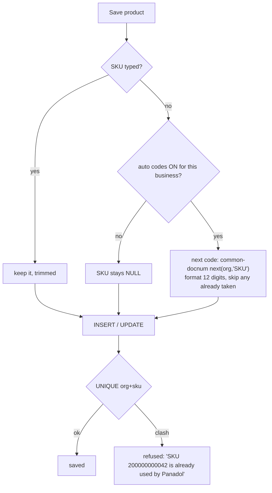

# 109 — SKU-AUTO: product codes generated per business, editable, unique

Status: **SKU-AUTO-1 BUILT** (2026-10-12) — awaiting deploy (catalog-service + monolith). SKU-AUTO-2/3 not started.

## 1. Requirement

> "During product registration `prodSku` is empty. Some users want it auto generated; the user can change it; it must be
> unique per tenant."

## 2. Review — what exists (Rule 0, counted)

| Fact | Evidence |
|---|---|
| SKU is optional; blank is stored NULL, never `''` | `ProductService.normalize()`, Flyway V5 (catalog) |
| Uniqueness is a service **pre-check** only — `existsBySkuScoped` on create (ProductService:180) and update (:295) | the index `idx_products_org_sku (organization_id, sku)` is **non-unique** (V9) → two admins saving the same code at once both succeed. STANDARDS / DUP-1: the UNIQUE index carries it, not a pre-check |
| Dev data: 7,691 products, **820 with no SKU**, **0 duplicate (org, sku)** | counted 2026-10-12 in container `myplusdb_catalog`; other environments **not counted** (D5) |
| A per-org, lock-serialised counter already exists: `common-docnum` (`DocumentNumberService.next(org, docType)`) | used by business, clinical, expense, finance, marketplace — **not catalog yet** |
| Product CSV import fills a blank SKU with `ITEM-<clientRef>`, also its re-import dedupe key | `ProductImportService` |
| The till's scan lookup already matches **barcode OR sku** | `ProductRepository` (barcode preferred) |
| Shelf labels already render CODE128 with JsBarcode | `labels.js` (U7 stickers) |

## 3. Market (researched 2026-10-12)

* **Lightspeed Retail** — every item gets a **12-digit System ID + matching barcode at creation**, never editable;
  a separate optional **Custom SKU** is the shop's own, unique per item.
* **Zoho Inventory** — "Generate SKU" from a pattern (attribute letters, separator, custom text), editable.
* **Odoo** — not built in; add-on modules fill a blank Internal Reference from a sequence (per category); the OCA module
  adds a unique SQL constraint.

## 4. Decisions (owner, 2026-10-12)

| # | Question | Decision |
|---|---|---|
| D1 | Code format | **Lightspeed style: 12-digit numeric, assigned at creation, scannable** |
| D1a | Is that 12-digit code the SKU itself (editable), or a separate fixed System ID beside an editable SKU? | **ONE code — the SKU itself, auto when blank, editable** (owner: "there must not be 2 separate codes", "auto but user can change it") |
| D2 | Products with no SKU today | **Filled automatically on deploy** |
| D3 | CSV import with a blank SKU | **Uses the auto number** when the feature is on |
| D4 | Print the auto code as a barcode on labels for items with no manufacturer barcode | **Yes** (slice SKU-AUTO-3) |

**D1a decided — the 12-digit code fills the SKU, and the SKU stays editable** (no second column). That is the owner's original
requirement ("user can change"), one code per product, and the till scan already finds it (lookup matches sku). A
separate immutable System ID (exact Lightspeed) adds a second code column, a second unique index and a second thing for
a cashier to read; worth it only if a code must survive the shop renaming its SKU (e.g. printed labels already on shelves).

## 5. Design

* **Format:** `2` + 11-digit zero-padded per-business counter → `200000000001`. The leading `2` keeps it out of the range
  real manufacturer (GS1) codes use for retail goods, so an auto code never collides with a scanned EAN/UPC. Printed as
  CODE128 (what `labels.js` already uses).
* **Assigned on SAVE, on the server, only when the SKU is blank.** Not reserved when the form opens (a cancelled form
  would burn a number; two users would see the same one). The form shows a placeholder: *"Assigned on save"*.
* **User can type their own or change it later.** The generator skips a number a user has already typed.
* **Allocation:** `common-docnum` in catalog-service (`org_document_seq`, docType `SKU`), called immediately before the
  insert — never before a remote call (allocate LATE).
* **Uniqueness:** replace the non-unique index with **UNIQUE (organization_id, sku)** — idempotent Flyway (D7), NULLs
  still allowed, case-insensitive under the default collation. The migration first COUNTS duplicates; if any exist it
  does not add the constraint and the deploy job reports them (never guesses which to rename — STANDARDS D5).
  The `existsBySkuScoped` pre-checks stay for a friendly message; the index decides.
* **Scope:** per business (organization), shared by its branches.
* **No setting:** "every product gets one" — a blank SKU is always filled. A blank box on EDIT keeps the code the
  product had (a product that never had one gets the next code), so every product keeps a SKU.
* **D2 — fill on deploy:** an idempotent startup job (the FP-6a pattern — repairs are jobs, not manual steps): for each
  business, products with `sku IS NULL` in id order get the next codes. Re-running finds none left. Logs a count per org.
* **D3 — CSV import:** a blank SKU takes the next auto code; the import's re-run dedupe moves off the `ITEM-<ref>` SKU
  onto the import's own client reference (to be traced in SKU-AUTO-2 before changing — Rule 0).

## 6. Slices

| Slice | Content | Gate |
|---|---|---|
| SKU-AUTO-1 | counter in catalog, generate on save when blank, setting, UNIQUE index + duplicate preflight, form placeholder | unit + Testcontainers (UNIQUE, concurrent saves) + Cypress: blank → 12-digit; typed kept; edit allowed; clash refused with a message; other tenant may reuse the same code; owner/admin/user ladder |
| SKU-AUTO-2 | deploy job fills the 820 blanks (idempotent), CSV import uses the counter | job test (run twice = same result), import spec |
| SKU-AUTO-3 | labels: print the SKU as a barcode for products with no manufacturer barcode | label spec (scan lookup finds the product by the printed code) |

## 7. Not in scope

Category-based prefixes (Odoo modules), Zoho-style attribute patterns, a separate immutable System ID (unless D1a says so).

## 8. SKU-AUTO-1 — as built (2026-10-12)

* catalog `V26__product_sku_auto_unique.sql`: `org_document_seq` (counter table) + `UNIQUE (organization_id, sku)`
  replacing `idx_products_org_sku` — only when 0 duplicates and InnoDB (dev recounted 2026-10-12: **0 duplicates**,
  7,698 products, 823 blank). Also declared on `Product` (`uq_products_org_sku`) so Hibernate-built test schemas carry it.
* `SkuAllocator` (common-docnum, doc type `SKU`): `'2' + %011d`, skips a number already typed, refuses after 1,000
  consecutive taken numbers; `null` for a legacy no-org row.
* `ProductService.create`: blank SKU → next code, last thing before the insert. `update`: blank keeps the old code.
* `ProductController`: a race lost to `uq_products_org_sku` → 409 "Product SKU already exists: X" (create and update).
* Monolith: `#prodSku` placeholder "Automatic if left blank" (6 languages).
* Not changed yet (SKU-AUTO-2): CSV import (`ITEM-<ref>`), the 823 existing blanks.

**Tests:** `SkuAllocatorTest` 4/4; `ProductSkuOptionalTest` 12/12 (Testcontainers — includes the index refusing a duplicate
past the pre-check, and another business reusing a SKU); full catalog suite **175/175, 0 skipped**. Gate
`product-sku-auto.cy.js` K1–K7: **red on the deployed build for the right reasons** (K1/K3/K7 SKU null, K6 no
placeholder); K2/K4/K5 green before and after (typed SKUs, the pre-check).

## 9. SKU-AUTO-2 — as built (2026-10-12)

**Trace correction:** the "`ITEM-<clientRef>` import code" in memory was stale — `ProductImportService` no longer exists.
The import is `ProductImportSpec` (common-import engine); its duplicate key is the product NAME, SKU optional.
**Gap found:** the import never checked a TYPED SKU against the business or the rest of the file — it could create
duplicate SKUs; under V26's unique index it would instead have failed the whole batch insert opaquely.

* common-import: `ImportSpec.uniqueColumns()` / `existingValues()` (default empty — `CustomerImportSpec` unaffected);
  engine **pass 3** checks them only on rows that would be CREATED (a re-uploaded row stays a SKIP, not a clash with
  itself), one batched read per column, case-insensitive like the collation; a clash is an ERROR → file refused.
* `ProductImportSpec`: `uniqueColumns = [sku]`, `existingSkusScoped` (one `IN` query); `persist` fills blank SKUs from
  `SkuAllocator` and saves in ONE transaction (codes and rows commit together).
* `SkuBackfill` (D2, deploy fill): on `ApplicationReadyEvent`, pages of 200 `sku IS NULL` rows (org not null, oldest
  first), `UPDATE … WHERE id=? AND sku IS NULL` (idempotent, a 2nd instance cannot overwrite), one transaction per
  page; logs legacy no-org blanks and duplicate-SKU groups (D5: report, never rename); never stops the service.

**Tests:** `ImportEngineTest` 16/16; `ProductImportSpecTest` 25/25 (+4: blank → code, typed kept; taken SKU refuses
the file; same SKU twice in a file; re-upload stays a skip); `SkuBackfillTest` 3/3 (Testcontainers: per-business
oldest-first, typed and legacy untouched, 2nd run = 0, hand-typed code skipped). Full catalog suite **182/182**, 0
skipped. ⚠ The suite log shows "Unexpected error occurred in scheduled task" ×21: `CatalogAuditService.pending`
(audit-outbox poller) in a CACHED test context whose MySQL container has stopped ("Connection is not available,
total=0") — harness noise, not a test failure, not from this slice. Gate K8–K10 added to `product-sku-auto.cy.js`.
