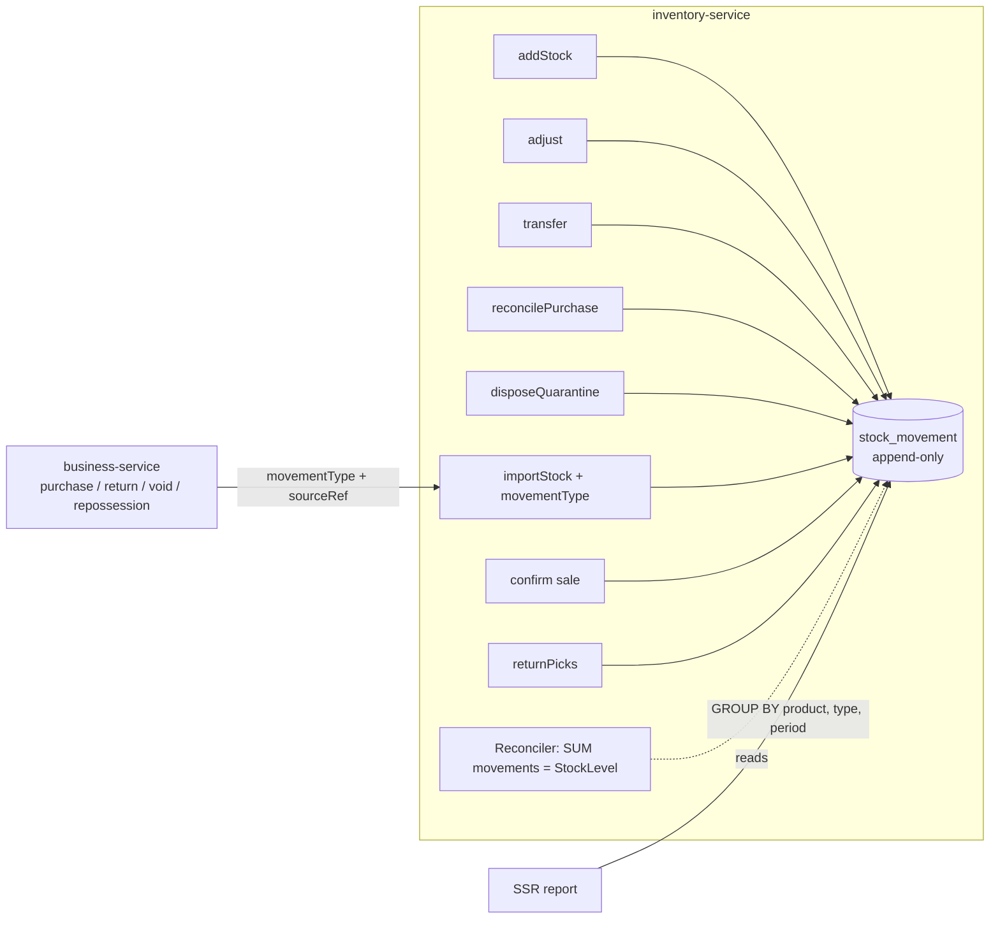

# 110 — SSR: the stock ledger, and the Stock & Sales Report built on it

Status: **DESIGN** (2026-10-12). Owner asked for the "DAVIS SSR" report (`Irfan requirements/DAVIS SSR.pdf`) and chose
"standards and best practices top-level companies follow" for every decision.

## 1. The report asked for

*Stock With Sales Report*, one row per product for a period, **grouped by SUPPLIER** (the account the products are
bought from — "DAVIS PHARMA", "DAVIS PHARMA (LIFE LINE)") with subtotals and a Net Total. Owner, 2026-10-12: "it is
actually the supplier the product was bought from" (not the manufacturer).

| Code | Item | Pack | TP | Opening | Purchase | Purch. Return | Total Stock | Sales Qty/Value | Sales Return Qty/Value | Net Sales Qty/Value | Bonus Qty/Value | Closing Qty/Value |

Verified on ACNE CARE CREAM: Total = −8 + 564 = 556; Net sales = 482 − 42 = 440; **Closing = 556 − 440 − 27 = 89**;
**Closing value = 89 × TP 104.65 = 9,314**; bonus value = qty × TP; sales value = actual selling price (55,620 / 482 =
115.39, not TP). A negative opening is printed as it is.

**Not part of the Sale Detail Report:** that one is per invoice LINE and sales only; this is per PRODUCT per PERIOD and
covers every movement. Different grain, different sources. A row may link to Sale Detail filtered to the product.

## 2. Review — what exists (Rule 0)

| Column | Source | State |
|---|---|---|
| Code / Item / Pack | Product SKU (SKU-AUTO), name, packSize/unit | ✅ |
| TP | `Product.lastPurchaseRate` (stamped per purchase, slice 107) | ✅ |
| Purchase, Purchase return | purchase bills / debit notes | ✅ quantities in business-service |
| Sales, Sales return, Bonus | sell lines (`bonus_quantity`), credit notes | ✅ business-service |
| Supplier group | `purchase.vender_id` per bill; `vender` ↔ `companies` (many-to-many); **the product holds no supplier** | ⚠ a product can be bought from several suppliers |
| **Opening / Closing** | **no dated record of stock movement exists** | ❌ |

**inventory-service keeps the CURRENT position only** (`StockLevel`, `StockEntry` batches, `StockAdjustment`,
`StockTransfer`). The operations that move stock — **8, counted** (grep of every quantity writer):

| # | Operation | Effect | Used for |
|---|---|---|---|
| 1 | `StockService.addStock` | IN | direct entry (opening stock, seeding) |
| 2 | `StockService.recordAdjustment` (`StockAdjustmentService.adjust`) | ± | stock correction |
| 3 | `StockService.transferStock` | − source / + target | branch transfer |
| 4 | `StockService.reconcilePurchase` | ± | purchase edit, purchase return |
| 5 | `StockService.disposeQuarantine` | OUT | quarantined returns disposed |
| 6 | `StockImportService.importStock` | IN | purchase receipt **and** sale-return restock, sale void, repossession — **one entry, four purposes; the line does not say which** |
| 7 | `ReservationService.confirm` | OUT | sale (paid + bonus, together) |
| 8 | `ReservationService.returnPicks` | IN (shelf or quarantine) | sale return |

Reserve / release / expiry-worker only HOLD stock; they move nothing on hand.

**Why opening cannot be derived from documents:** #1, #2, #3, #5 have no business document, so "opening = now − later
documents" would not reconcile with the shelf — and would say so to no one (STANDARDS §0b, never optimistic).

## 3. Decisions (owner: "standards and best practices")

| # | Decision | The standard |
|---|---|---|
| D1 | **Group by the product's MAIN SUPPLIER** (owner's correction): `Product.mainSupplierId` (a `vender` id) — **filled automatically from the product's FIRST purchase when blank, editable on the product form, never moved automatically afterwards** (a one-off buy elsewhere must not move the product between groups). Never purchased → "No supplier". Report filter: one supplier, all, or a company (its suppliers) | SAP *regular vendor* (source list), Odoo product vendor list (first-ranked vendor) — an explicit main vendor, not "whoever we bought from last" |
| D2 | **TP = the product's current trade price (`lastPurchaseRate`, per pack); closing and bonus values at TP** — the convention of the SSR every principal receives. **The books keep valuing stock at actual batch cost (FIFO)** | SSR is an operational report in the principal's price; financial valuation follows IAS 2 cost and is separate |
| D3 | **Purchase qty = every unit received, supplier bonus included** (paid / free shown in the drill-down) | stock follows physical movement (SAP/Odoo goods receipt) — otherwise the row does not add up |
| D4 | **A stock LEDGER first (SSR-0), the report on it (SSR-1)** | SAP material documents, Odoo `stock.move`, Tally stock vouchers |

## 4. Design — SSR-0, the stock ledger

* **`stock_movement`** (inventory DB, append-only — never updated, never deleted): org, warehouse/store, product,
  batch (`stock_entry_id`), `movement_type`, **signed quantity in packs**, `unit_cost` (the batch's cost at the time),
  `source_type` + `source_ref` (bill / invoice / note no.), `business_date` (TenantClock — TZ-2), `created_at`, user.
  Index `(organization_id, product_id, business_date)`.
* **Written in the SAME transaction as the stock change, through one class** (`StockLedger.record`), at all 8 writers —
  so a movement without its ledger row cannot commit (no outbox needed: same service, same database).
* **Movement types:** OPENING, PURCHASE, PURCHASE_RETURN, PURCHASE_EDIT, SALE, SALE_BONUS, SALE_RETURN, SALE_VOID,
  REPOSSESSION, ADJUSTMENT, TRANSFER_OUT, TRANSFER_IN, QUARANTINE_DISPOSE. A sale writes SALE and SALE_BONUS as two rows
  (the reservation line carries the bonus quantity) so the SSR's Bonus column comes from the ledger itself.
* **Contract change:** `StockImportLine.movementType` + `sourceRef` (default PURCHASE — today's meaning), set by the 4
  business callers (purchase, sale-return restock, sale void, repossession); `StockReservationLine.bonusQuantity`.
  Every field traced through all its hops before the change (GL-outbox lesson: a new contract field = every place).
* **Go-live (cutover):** one idempotent job writes an **OPENING** movement per batch = its quantity at go-live, dated
  go-live. From then on, opening + movements = on hand by construction. Periods BEFORE go-live are not reported (the
  report says so) — never reconstructed from documents that cannot account for corrections and transfers.
* **Reconciler** (daily + on start, idempotent): per product and warehouse, SUM(movements) must equal
  `StockLevel.currentStock`; a difference is LOGGED and listed for the owner, **never silently booked** (§0b, D5).

## 5. Design — SSR-1, the report

* Business dashboard → Reports → **Stock & Sales (SSR)**: date range, supplier (one / all / a company's suppliers), branch.
* One aggregate query on the ledger (GROUP BY product, movement_type, before/within the period) + one batched product
  read from catalog (name, SKU, pack, TP, mainSupplierId) + supplier names from business — no per-row calls (PERF).
* Sales VALUE and sales-return VALUE from business-service sell lines / credit notes, aggregated per product for the
  period (one call); quantities from the ledger. A mismatch between the two sources is shown, not hidden.
* Columns exactly as the PDF, plus **Adjustments** (shown only when non-zero) so every row adds up:
  Closing = Opening + Purchase − Purchase return − Net sales − Bonus ± Adjustments ± Transfers − Disposed.
* Grouped by supplier with subtotals and a Net Total; on screen, PDF (landscape, pdfmake) and Excel/CSV; header =
  business name, address, phone, period; printed date and page x of y.

## 6. Slices

| Slice | Content | Gate |
|---|---|---|
| SSR-0a | `stock_movement` + `StockLedger.record` at all 8 writers + contract fields + the 4 business callers | unit per writer (the movement row matches the stock change); Testcontainers: SUM = on hand after a mixed sequence |
| SSR-0b | go-live OPENING job + reconciler | job idempotent (run twice = same); reconciler flags a planted difference |
| SSR-0c | `Product.mainSupplierId` (catalog) stamped by the first purchase (business → catalog, beside the last-rates stamp) + product-form supplier picker + one-time fill from each product's FIRST non-void purchase | stamp only when blank (a 2nd supplier does not move it); form edit; fill idempotent, counted |
| SSR-1 | the report screen + PDF + CSV | Cypress: a scripted month (opening, purchase, return, sale, bonus, sale return, correction) gives the exact row; totals and Net Total; ladder owner/admin/user |

## 7. Not in scope

Valuation reports at cost (exist separately), periods before go-live, multi-currency.

## 8. SSR-0a / SSR-0b — as built (2026-10-12)

**Trace corrections (Rule 0):**
* `transferStock` only RECORDS a transfer row — it moves no quantity, and `stock_levels` is per business, not per
  warehouse. So **7** operations move stock, through exactly **5 writers of `current_stock`**: sale confirm, return
  (`bumpLevel`), `importStock`, `addStock`, `applyStockDelta` (correction + purchase reconcile). Transfers are not in
  the ledger (they change nothing on-hand).
* The ledger tracks **sellable on-hand** exactly as `stock_levels` does: `applyStockDelta` clamps at zero, so the row
  records the change APPLIED (new − old level), not the requested delta; a quarantined return does not raise on-hand,
  so it is written as SALE_RETURN +q and QUARANTINE −q (net 0) — the report still counts the return.
* **Sale vs bonus:** a reservation carries paid + bonus together and inventory never sees the split. Rather than
  change the sale path, the ledger's SALE row is the physical total (SAP's material document) and the SSR takes the
  Sales / Bonus split from the sell line's `bonus_quantity`, checking ledger SALE = paid + bonus per row (a mismatch is
  shown). `StockReservationLine.bonusQuantity` is therefore NOT added.

**Built:** catalog of types `StockMovementType` (commerce-contracts); `movementType` + `sourceRef` on
`StockImportLine`, `StockReturnRequest`, `StockPurchaseAdjust` (absent → RECEIPT / SALE_RETURN / PURCHASE_EDIT); the
business callers tag every call — PurchaseService (PURCHASE, PURCHASE_EDIT, PURCHASE_RETURN — a void reuses the
return), SellController (SALE_EDIT ×2, SALE_RETURN ×2), SaleVoidService (SALE_VOID ×2), RepossessionService
(REPOSSESSION ×2); marketplace's order return takes the default SALE_RETURN. inventory V15 `stock_movement`,
`StockLedger.record` (MANDATORY transaction), hooks at the 5 writers. SSR-0b `StockLedgerCutover`: OPENING per
product under a row lock (= on-hand − ledger so far; a 0 OPENING is the cut-over marker), reconciler on start + daily
03:30, `GET /api/inventory/stock/ledger/differences` (read-only, scoped).

**Tests:** `StockLedgerTest` 8/8 and `StockLedgerCutoverTest` 4/4 (Testcontainers); inventory suite 89/89 unchanged.

## 9. SSR-0c / SSR-1 — as built (2026-10-12)

**SSR-0c — main supplier.** catalog V27 `products.main_supplier_id` (+ index with the tenant); `Product.mainSupplierId`
on `ProductDTO` / `ProductRef`. Two endpoints, never the product save (a partial save must not clear it):
`PUT /products/{id}/main-supplier/stamp` (any purchaser — kept only when BLANK) and `PUT /products/{id}/main-supplier`
(ADMIN — set or clear). `PurchaseService.stampMainSupplier` on receive (best-effort; a cash purchase names nobody).
Products bought before this: the report falls back to their FIRST non-void purchase's supplier
(`PurchaseRepo.firstSupplierByProduct`) — no cross-service back-fill job. Product form: "Main supplier" picker
(owner/admin), saved through its own call only when the user CHANGED it.

**SSR-1 — the report.**
* inventory `GET /stock/ledger/summary?from&to` — ONE grouped query: per product, opening (before the period), each
  movement type within it, closing; plus `ledgerStart` (first OPENING).
* business `GET /stockSalesReport?from&to[&supplierId|&companyId]` (owner/admin) — `StockSalesReportService`:
  quantities from the ledger; sales VALUE = the period's sale lines (reduced in place by returns) + the value of their
  returns (by original invoice date) = GROSS; return value = credit notes dated in the period (packs × V65 unit_rate,
  else refund + credit); bonus from the lines; TP = `lastPurchaseRate` (now on `ProductRef`). Group = main supplier,
  else first purchase's supplier, else "No supplier" (last). Each row carries `adds` (Total − Net − Bonus + Adjust =
  Closing); unclassified movement types fall into Adjustments, OPENING inside the period into Opening.
* ⚠ **Found in the owner's PDF: its Net Sales Value is NOT Sales − Returns** (ACNE 55,620 − 4,675 = 50,945, PDF 51,480 =
  440 × 117; CRANBERRY 833 × 138; CALPLEX 183 × 88) — that system values net sales at a fixed LIST price. Ours is the
  money actually taken (Sales − Returns), which reconciles with the books and the Sale Detail Report. Bonus and
  closing at TP match the PDF.
* monolith: proxies `/stockSalesReport`, `/setProductMainSupplier`; Finance menu → "Stock & Sales (SSR)"; `ssr.js`
  (screen grouped with subtotals + Net Total, Adjust column only when non-zero, before-ledger notice, landscape PDF via
  the shared lazy pdfmake, CSV); 34 keys × 6 languages.

**Tests:** `StockSalesReportRowTest` 5/5 (the PDF's ACNE row: closing 89, bonus 27 × TP, `adds`); `StockLedgerCutoverTest`
5/5 (period summary reproduces ACNE: −8 + 564 − 509 + 42 = 89); `ProductMainSupplierTest` 3/3; `PurchaseMainSupplierTest`
3/3. Gate `ssr-stock-sales-report.cy.js` R1–R6 (scripted month → closing 63 / 3,150) — awaits deploy of inventory,
catalog, business and the monolith.

## 10. Deployed and verified (owner-deployed 2026-10-13 06:29; inventory first at 2026-10-12 23:31)

* V15 (inventory) and V27 (catalog) applied. Cut-over: **6,013 OPENING rows for 6,013 stock levels**; reconciler query:
  **0 products whose ledger ≠ on-hand, 0 levels without an OPENING**. One RECEIPT row (org 15, +20, 23:33) — a receipt
  made while business-service still ran the pre-SSR build (untagged → the designed default), shown under Adjust.
* Gate `ssr-stock-sales-report.cy.js` **6/6** (first run, and twice more for capture); the spec product's ledger is
  exactly PURCHASE +100 · SALE −30 · SALE_RETURN +5 · PURCHASE_RETURN −10 · ADJUSTMENT −2 with their documents.
* Regression: purchase 22, purchase-edit-keeps-issued 2, product-last-rates 7, purchase-expiry-required 7,
  product-sku-auto 14, void-cancel 3, purchase-return 1, bonus-schemes-p3 14, pos-sale-endtoend 6, label-print 8
  (**84/84**). ⚠ `sale-return-loose-units` 0/6 — NOT SSR: EXP-REQ (4818b0bd) refuses its purchases. It creates products
  with `/addProduct` directly (not `cy.seedProduct`, which marks spec products "No expiry") on demo.business (expiry
  tracked). Same pattern in 11 more specs (10 on demo.business + pharmacy/prescriptions-tab-walk) — awaiting the owner.
* Step-by-step test page: https://claude.ai/artifact/9Pm3pwn7FzL4gCbmRF8MMd (cases SETUP, S1–S5, R2, R4–R6, L1; four
  screenshots from the passing run). Styling for the report table (theme.css) added after the capture — needs the
  monolith redeployed.

**EXP-REQ fixture gap closed (2026-10-13):** 8 specs that create products with `/addProduct` on demo.business now call
the shared `cy.markNoExpiry` (already in commands.js, used by `seedProduct`): sale-return-loose-units,
quote-loose-units, restaurant-menu-setup, sale-report-profit, e2e-pack-purchase-sell-finance, purchase-batch-prefill,
purchase-self-describing, pack-loose-ux-labels (pack-loose-ux-till and prescriptions-tab-walk already did; product-crud
and negative never buy their own products). Also fixed: restaurant-menu-setup built every menu item's SKU in the same
millisecond with a 1-in-1000 suffix → "Product SKU already exists" (a counter now). Results: 6 of 8 green; the other
two fail ONLY on loose prices ×1.10 — demo.business has `pos.sale.looseMarkupPct = 10`, saved by its owner account
at 2026-10-13 07:25:48 (default 0); left for the owner to confirm before it is reset.
